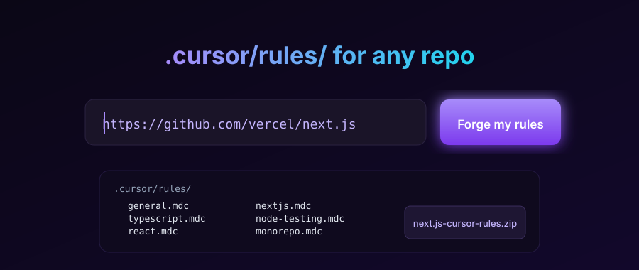

# cursor-rules-forge

<p align="center">
  
</p>

<p align="center">
  <b>Paste a GitHub URL. Get a tuned <code>.cursor/rules/</code> folder.</b><br/>
  Detects React, Next.js, Vue, Svelte, monorepo tooling (turbo/nx), Python + pytest,
  Rust and Go — and emits real <code>.mdc</code> rule files zipped up ready to drop into your repo.
</p>

<p align="center">
  <a href="https://cursor-rules-forge.vercel.app"><b>Try it live →</b></a>
  &nbsp;·&nbsp;
  <a href="#how-it-works">How it works</a>
  &nbsp;·&nbsp;
  <a href="#cli">CLI</a>
  &nbsp;·&nbsp;
  <a href="#api">API</a>
</p>

---

## How it works

1. **Fetch** — Octokit pulls the repo's file tree plus a handful of key files: `package.json`, `tsconfig.json`, `requirements.txt`, `pyproject.toml`, `Cargo.toml`, `go.mod`, `turbo.json`, `nx.json`, `pnpm-workspace.yaml`, `.eslintrc*`.
2. **Detect** — A deterministic classifier parses `package.json` deps, checks lockfiles, spots monorepo tooling, and looks for test setup. No LLM calls. Same input → same output, every time.
3. **Forge** — For each detected category we emit a curated `.mdc` file in real Cursor format (`--- description / globs / alwaysApply ---` frontmatter + rule body). Everything gets zipped as `.cursor/rules/*.mdc` and streamed back to the browser as a download.

## Install & run locally

```bash
git clone https://github.com/Danush-Aries/cursor-rules-forge
cd cursor-rules-forge
pnpm install     # or: npm install
pnpm dev         # http://localhost:3000
```

Optional: set `GITHUB_TOKEN` in `.env.local` to raise your GitHub API rate limit from 60 → 5000/hr.

```bash
# .env.local
GITHUB_TOKEN=ghp_xxx
```

## API

The web UI is a thin wrapper around a single POST endpoint:

```bash
curl -X POST https://cursor-rules-forge.vercel.app/api/forge \
  -H 'Content-Type: application/json' \
  -d '{"url":"https://github.com/vercel/next.js"}' \
  --output next.js-cursor-rules.zip
```

Response headers tell you what was detected:

- `X-Forge-Categories` — comma-separated rule categories emitted (e.g. `general,typescript,react,nextjs,monorepo`)
- `X-Forge-Language` — inferred primary language
- `X-Forge-Framework` — `nextjs`, `react`, `vue`, `svelte`, or empty
- `X-Forge-Monorepo` — `turborepo`, `nx`, `pnpm-workspaces`, or empty

## CLI

A Go binary lives in [`cli/`](./cli). Point it at a directory, get `.cursor/rules/` written in place — no network calls, no ZIP.

```bash
cd cli
go build -o forge .
./forge ~/Developer/my-project
```

See [cli/README.md](./cli/README.md) for details.

## Rule templates

Curated defaults live in [`templates/`](./templates):

| File | Applies to |
|---|---|
| `general.mdc` | everything — dead code, magic numbers, error swallowing |
| `typescript.mdc` | `**/*.{ts,tsx}` — no `any`, `type` over `interface`, discriminated unions |
| `react.mdc` | `**/*.{tsx,jsx}` — no `useEffect` for fetching, server components, memo hygiene |
| `nextjs.mdc` | `app/**/*.{ts,tsx}` — server-first, Server Actions over route handlers |
| `vue.mdc` | `**/*.vue` — Composition API, `<script setup>`, Pinia |
| `svelte.mdc` | `**/*.svelte` — runes, `+page.server.ts` loaders, form actions |
| `python.mdc` | `**/*.py` — stdlib first, `pathlib`, no mutable defaults |
| `python-testing.mdc` | `**/{test_*,*_test}.py` — fixtures, `tmp_path`, parametrize |
| `node-testing.mdc` | `**/*.{test,spec}.{ts,tsx,js,jsx}` — vitest, Playwright waits |
| `rust.mdc` | `**/*.rs` — no `unwrap`, `thiserror`/`anyhow`, `// SAFETY:` |
| `go.mdc` | `**/*.go` — errors as values, `ctx` first, table-driven tests |
| `monorepo.mdc` | `**/package.json` — package-owned deps, turbo pipelines |

Adapted from and inspired by [PatrickJS/awesome-cursorrules](https://github.com/PatrickJS/awesome-cursorrules) — the source of truth for community-authored rule packs.

## Optional: LLM polish (`PONYTAIL_MODE=1`)

The primary path is fully deterministic and zero-cost. If you set `PONYTAIL_MODE=1`
(and provide an `ANTHROPIC_API_KEY` or `OPENAI_API_KEY`) the forge route will
attempt a "polish pass" over the generated rules — smoothing wording,
deduplicating overlap, and injecting one or two repo-specific notes based on
the detected stack tags.

This is intentionally *off* by default. The whole point of this tool is that
you can commit its output without waiting for an API, without paying for
tokens, and without your rules drifting between runs.

## Deploy

The `vercel.json` at the repo root wires the app up for Vercel. `pnpm build`
locally to confirm before pushing. The `/api/forge` route is configured with
`maxDuration: 30` since large repos can take a few seconds for the tree fetch.

## Structure

```
cursor-rules-forge/
├── app/
│   ├── api/forge/route.ts    # POST endpoint: fetch → detect → zip
│   ├── page.tsx              # Landing page
│   └── layout.tsx
├── components/
│   ├── forge-form.tsx        # Client form: URL input + download handler
│   └── ui/button.tsx         # shadcn/ui Button
├── lib/
│   ├── github.ts             # Octokit repo snapshot
│   ├── detector.ts           # Deterministic stack classifier
│   ├── rules-builder.ts      # Category → .mdc content
│   └── utils.ts
├── templates/                # Source-of-truth .mdc files (for CLI + docs)
├── cli/                      # Go CLI — same detection, local
└── public/hero.svg           # Animated hero mockup
```

## License

MIT © [Dhanush Shankar](https://github.com/Danush-Aries)
